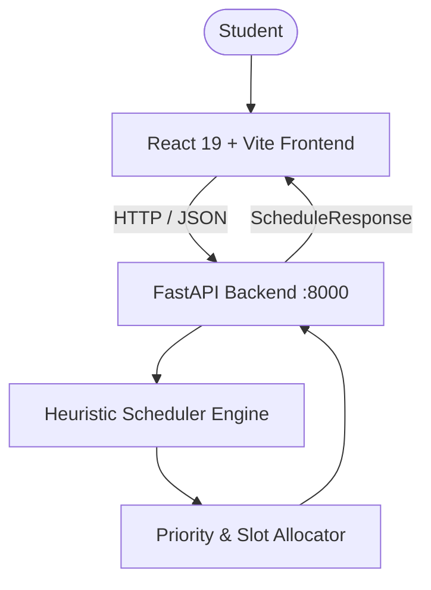

# FocusFlow AI Study Planner

> **FocusFlow** is an intelligent, adaptive study scheduling platform designed for students. It models timetable generation as a constraint-based optimization problem using heuristic priority scoring, automatically balancing subject difficulty, approaching deadlines, and dynamic rescheduling for missed tasks.

---

## 🌟 Key Features

- **⚡ Heuristic AI Scheduling Engine**: Automatically scores and prioritizes subjects using urgency factors, difficulty weights, and dynamic boost formulas.
- **🔄 Adaptive Rescheduling**: When a study slot or task is marked as "Missed", the engine dynamically recalculates priorities and rebalances remaining study blocks.
- **📅 Visual Weekly Timetable**: Interactive timetable mapping scheduled subjects into user-defined study windows and time slots.
- **🎯 Task & Status Tracking**: Manage subjects, difficulty levels (*Easy*, *Medium*, *Hard*), deadlines, and progress states (*Planned*, *In Progress*, *Missed*, *Completed*).
- **⏱️ Flexible Time Slot Configuration**: Customize daily study availability and preferred time windows.
- **🔌 Offline-Resilient Frontend**: Automatically falls back to in-browser scheduling logic if the backend service is offline.

---

## 🏗️ System Architecture



FocusFlow follows a modular architecture separating presentation, API routing, and scheduling algorithms:
1. **User Input Module**: Captures subjects, deadlines, difficulty ratings, and availability windows.
2. **Scheduler Engine**: Computes priority metrics and assigns tasks to appropriate time slots.
3. **Constraint Handler**: Enforces deadline restrictions and daily slot capacity.
4. **Adaptive Engine**: Boosts urgency and re-evaluates schedules when tasks are missed.
5. **Visualization Module**: Renders an intuitive calendar and timetable layout.

---

## 🧠 Scheduling Algorithm & Logic

The scheduler calculates a dynamic priority score for each task:

$$\text{Priority} = \left(\frac{12}{\text{deadline\_days}}\right) + (\text{difficulty\_weight} \times 1.8) + \text{adaptive\_boost}$$

- **Difficulty Weight**:
  - `Easy`: $1$
  - `Medium`: $2$
  - `Hard`: $3$
- **Deadline Urgency**: Shorter deadlines receive higher inverse-weight scores ($12 / \text{deadline\_days}$).
- **Adaptive Boost**: Tasks flagged as `Missed` receive an immediate $+3.0$ priority boost to recover lost study time.

---

## 🛠️ Tech Stack

| Layer | Technologies |
|---|---|
| **Frontend** | React 19, Vite 6, Lucide Icons, Modern CSS |
| **Backend** | Python 3.10+, FastAPI, Pydantic v2, Uvicorn |
| **Persistence (Planned)** | MongoDB / Browser LocalStorage |

---

## 📁 Repository Structure

```text
FocusFlow/
├── backend/
│   ├── main.py              # FastAPI app & heuristic scheduling algorithms
│   ├── requirements.txt     # Python dependencies
│   └── .venv/               # Virtual environment (local)
├── frontend/
│   ├── src/
│   │   ├── main.jsx         # React UI, task manager & timetable views
│   │   └── styles.css       # Responsive styling & themes
│   ├── index.html           # HTML template
│   ├── vite.config.js       # Vite configuration
│   └── package.json         # NPM dependencies and scripts
├── details.md               # Architecture design & specifications
└── README.md                # Project documentation
```

---

## 🚀 Getting Started

### Prerequisites

- **Node.js**: v18.0.0+ or v20.0.0+ (Tested on v20.18+)
- **Python**: 3.10+
- **Git**

---

### 1. Backend Setup

Open a terminal and navigate to the `backend` folder:

#### On Windows (PowerShell):
```powershell
cd backend

# Create virtual environment
python -m venv .venv

# Activate virtual environment
.\.venv\Scripts\Activate.ps1

# Install dependencies
pip install -r requirements.txt

# Start FastAPI server
uvicorn main:app --reload --port 8000
```

#### On macOS / Linux (Bash):
```bash
cd backend

# Create virtual environment
python3 -m venv .venv

# Activate virtual environment
source .venv/bin/activate

# Install dependencies
pip install -r requirements.txt

# Start FastAPI server
uvicorn main:app --reload --port 8000
```

The backend API will be available at:
- **Base URL**: `http://localhost:8000`
- **Health Check**: `http://localhost:8000/api/health`
- **Swagger Docs**: `http://localhost:8000/docs`

---

### 2. Frontend Setup

Open a **separate terminal** and navigate to the `frontend` folder:

```powershell
cd frontend

# Install dependencies
npm install

# Start Vite development server
npm run dev
```

Open your browser at **`http://localhost:5173`** (or the port displayed in your terminal).

---

## 📡 API Reference

### Health Check
- **Endpoint**: `GET /api/health`
- **Response**:
  ```json
  { "status": "ok" }
  ```

### Generate Schedule
- **Endpoint**: `POST /api/schedule`
- **Payload**:
  ```json
  {
    "tasks": [
      {
        "id": 1,
        "subject": "Artificial Intelligence",
        "deadline_days": 2,
        "difficulty": "Hard",
        "status": "In progress"
      },
      {
        "id": 2,
        "subject": "Operating Systems",
        "deadline_days": 5,
        "difficulty": "Medium",
        "status": "Planned"
      }
    ],
    "available_slots": [
      { "day": 0, "start": "09:00", "end": "11:00" },
      { "day": 0, "start": "17:00", "end": "20:00" },
      { "day": 1, "start": "09:00", "end": "11:00" }
    ],
    "locked_schedule": []
  }
  ```
- **Response**: Returns scheduled study items with priority rankings and calculated timetable slots.

---

## 📄 License

This project is open source and available under the [MIT License](LICENSE).
