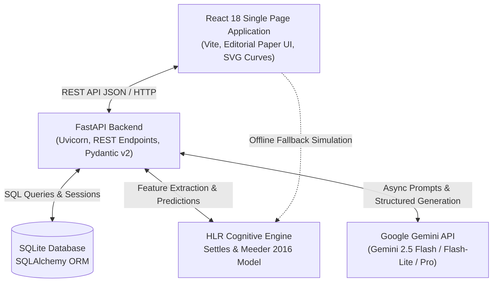

# FocusFlow Documentation Hub

Welcome to the comprehensive technical documentation for **FocusFlow** — an intelligent, adaptive spaced-repetition learning platform powered by **Half-Life Regression (HLR)** and **Google Gemini AI**.

FocusFlow merges cognitive science memory modeling with state-of-the-art Large Language Models to deliver personalized study scheduling, active recall testing, automated quiz generation, and AI-driven tutoring.

---

## 📚 Documentation Index

| Document | Purpose | Key Topics Covered |
| :--- | :--- | :--- |
| **[Architecture Overview](file:///d:/Github%20repositories/FocusFlow/docs/architecture_overview.md)** | System Design & HLR (High-Level Requirements) | System topology, tech stack, data flow, component interactions, directory layout. |
| **[HLR Mathematical Model](file:///d:/Github%20repositories/FocusFlow/docs/hlr_mathematical_model.md)** | Cognitive Science & Math Foundations | Duolingo Settles & Meeder (2016), Ebbinghaus curve, half-life formula, AdaGrad, scheduling math. |
| **[Backend Architecture](file:///d:/Github%20repositories/FocusFlow/docs/backend_architecture.md)** | Server & Database Engine | FastAPI, SQLAlchemy ORM, SQLite schema, endpoint directory, idempotency, clock simulation. |
| **[Frontend Guide](file:///d:/Github%20repositories/FocusFlow/docs/frontend_guide.md)** | Client-Side Architecture & UI | React 18, Vite, Editorial Paper design system, SVG curve rendering, 3D cards, offline fallback. |
| **[AI Integration](file:///d:/Github%20repositories/FocusFlow/docs/ai_integration.md)** | Gemini 1.5 / 2.0 Integration | Socratic Study Buddy, Deep Doubt Solver, Mnemonic Lab, Quiz Generator, prompt templates. |
| **[Demo & Presentation Guide](file:///d:/Github%20repositories/FocusFlow/docs/demo_guide.md)** | Demonstration & Viva Walkthrough | Step-by-step demo script, live feature tour, math visualization showcase, defense Q&A. |

---

## ⚡ Quick Architecture Summary



---

## 🚀 Running the Project

### Prerequisites
- **Python 3.10+** (with virtual environment)
- **Node.js 18+** & `npm`
- **Google Gemini API Key** (optional for basic HLR features, required for AI tutoring & generation)

### 1. Backend Server Setup
```bash
# Navigate to backend directory
cd backend

# Activate virtual environment
# Windows:
.venv\Scripts\activate
# Linux/macOS:
# source .venv/bin/activate

# Install dependencies
pip install -r requirements.txt

# Start backend server
uvicorn main:app --reload --port 8000
```
- Interactive Swagger UI: [http://localhost:8000/docs](http://localhost:8000/docs)
- Alternative ReDoc: [http://localhost:8000/redoc](http://localhost:8000/redoc)

### 2. Frontend Client Setup
```bash
# In a new terminal, navigate to frontend directory
cd frontend

# Install npm dependencies
npm install

# Start Vite dev server
npm run dev
```
- Web Application: [http://localhost:5173](http://localhost:5173)

---

## 📁 Repository Structure

```text
FocusFlow/
├── backend/
│   ├── app/
│   │   ├── core/           # Config, database setup, environment loader
│   │   ├── models/         # SQLAlchemy ORM entity definitions
│   │   ├── routers/        # REST API route handlers
│   │   │   ├── ai_features.py  # Chatbot, Doubt Solver, Mnemonic Lab
│   │   │   ├── concepts.py     # Concept management & curves
│   │   │   ├── dashboard.py    # Readiness metrics & alerts
│   │   │   ├── materials.py    # Notes ingestion & AI extraction
│   │   │   ├── plan.py         # Adaptive study schedule
│   │   │   ├── quizzes.py      # Quiz questions & generation
│   │   │   ├── sessions.py     # Practice sessions & attempts
│   │   │   └── settings.py     # User preferences & weights
│   │   ├── schemas/        # Pydantic v2 request/response schemas
│   │   └── services/       # Core business logic
│   │       ├── ai_tutor.py     # Gemini client & prompt templates
│   │       ├── hlr.py          # Settles & Meeder 2016 mathematical model
│   │       ├── quiz_gen.py     # AI question extraction pipeline
│   │       └── scheduler.py    # Daily budget & priority scheduling
│   ├── tests/              # Pytest test suite (19 test cases)
│   ├── main.py             # FastAPI entrypoint, lifespan & clock injection
│   └── requirements.txt    # Python dependencies
├── frontend/
│   ├── src/
│   │   ├── hlr.js          # Client-side HLR simulation engine
│   │   ├── main.jsx        # Root application & tab views
│   │   └── styles.css      # Custom Editorial Paper design system
│   ├── index.html          # HTML entry point with Google Fonts
│   ├── package.json        # Frontend scripts and packages
│   └── vite.config.js      # Vite build configuration
└── docs/                   # Full project documentation suite
```
