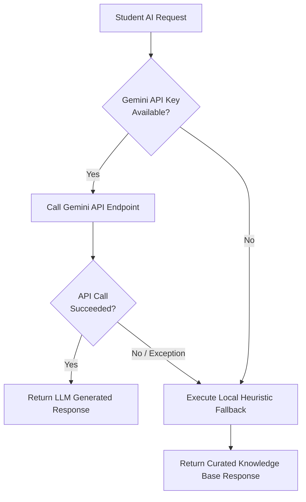

# Google Gemini AI Integration & Prompt Engineering

## 1. Overview

FocusFlow integrates **Google Gemini** to augment its cognitive spaced repetition engine with personalized generative learning capabilities. 

Rather than treating AI as a generic chatbot widget, FocusFlow deploys targeted prompt templates and structured JSON response pipelines across four specialized modules:
1. **Socratic Study Buddy (`/api/ai/chat`)**: Multi-turn dialogue guiding students through concepts using inquiry-based scaffolding.
2. **Deep Doubt Solver (`/api/ai/solve-doubt`)**: Multi-stage breakdown providing direct answers, intuitive real-world analogies, misconception warnings, and check questions.
3. **Mnemonic Laboratory (`/api/ai/mnemonics`)**: Generates 4 distinct memory anchors (Acronym, Visual Story, Metaphor, Rhyme) tailored to abstract concepts.
4. **Material Ingestion & Quiz Generator (`/api/quizzes/generate`)**: Converts unstructured lecture notes and textbooks into syllabus concepts and validated multiple-choice questions.

All backend AI logic is centralized in [backend/app/services/ai_tutor.py](file:///d:/Github%20repositories/FocusFlow/backend/app/services/ai_tutor.py) and exposed via [backend/app/routers/ai_features.py](file:///d:/Github%20repositories/FocusFlow/backend/app/routers/ai_features.py).

---

## 2. API Configuration & Dynamic Key Resolution

FocusFlow implements dynamic environment resolution in [backend/app/core/config.py](file:///d:/Github%20repositories/FocusFlow/backend/app/core/config.py):

```python
# The resolver automatically checks multiple locations in order:
# 1. System environment variables (GEMINI_API_KEY)
# 2. backend/.env
# 3. Project root .env
```

### Model Selection Hierarchy
To ensure high availability and responsiveness, the client queries Gemini using a model fallback ladder:
1. `gemini-2.5-flash`: Default model for sub-second responses and high reasoning fidelity.
2. `gemini-2.5-flash-lite`: Fast, lightweight fallback for rapid doubt clarification.
3. `gemini-1.5-flash`: Proven stable fallback for long-form note extraction.

---

## 3. Specialized AI Modules & Prompt Templates

### 3.1 Socratic Study Buddy
The Socratic Study Buddy acts as a supportive academic mentor. It is instructed to guide the student toward understanding rather than immediately spoiling answers to practice problems.

```python
SYSTEM_PROMPT = """You are FocusFlow Socratic Study Buddy, an expert academic tutor.
Your goal is to help the student deeply understand concepts through guided inquiry and active recall.

Pedagogical Rules:
1. Never give the direct multiple-choice answer or solution immediately if the student is working on a problem.
2. Provide a helpful conceptual hint, ask a targeted guiding question, or break down the underlying principle.
3. Use clear, engaging language with markdown formatting for formulas, code snippets, or bullet points.
4. Keep explanations concise, focused, and academically rigorous.
5. If the student demonstrates the correct understanding, validate their reasoning enthusiastically and offer a deeper follow-up connection.
"""
```

### 3.2 Deep Doubt Solver
When students encounter difficult conceptual hurdles, standard explanations are often too abstract. The Doubt Solver prompts Gemini to return a structured four-part explanation:

```text
Prompt Format:
Subject: {subject}
Concept: {concept}
Student Doubt: {doubt}

Please provide a structured 4-part explanation:
1. Direct Conceptual Clarification (crisp, accurate explanation in 2-3 sentences).
2. Intuitive Real-World Analogy (grounded in everyday objects or scenarios).
3. Common Misconceptions (what students often confuse or get wrong about this).
4. Active Check Question (a quick conceptual question with options/answer to verify understanding).
```

### 3.3 Mnemonic Laboratory
Abstract definitions (like the four Coffman conditions for deadlock, or the phases of Paxos consensus) are prone to rapid memory decay. The Mnemonic Lab generates four complementary memory anchors:

```text
Concept: {concept_name}
Subject: {subject}
Details: {description}

Generate four distinct memory anchors:
1. Acronym Anchor: A memorable acronym using key letter components with expansion.
2. Visual Story Anchor: A vivid, slightly bizarre mental image linking the concepts together.
3. Metaphor Anchor: An intuitive real-world mechanism that operates identically.
4. Rhyme or Phonetic Hook: A catchy rhythm or phrase that sticks in the auditory memory.
```

### 3.4 Notes Ingestion & Quiz Question Generator
In [backend/app/services/quiz_gen.py](file:///d:/Github%20repositories/FocusFlow/backend/app/services/quiz_gen.py), students can upload raw markdown or text notes. The generation pipeline executes a zero-shot prompt with strict JSON schema formatting:

```json
{
  "questions": [
    {
      "text": "Why do standard Transformer architectures divide the query-key dot product by sqrt(d_k)?",
      "options": [
        "To prevent large dot products from pushing softmax into vanishing gradient regions",
        "To force attention weights to sum to sqrt(d_k)",
        "To guarantee orthogonality between Query and Key matrices",
        "To reduce computational complexity from O(n^2) to O(n)"
      ],
      "answer_index": 0,
      "explanation": "As d_k grows large, dot products grow large in magnitude, pushing softmax into regions with tiny gradients. Scaling by 1/sqrt(d_k) counteracts this effect."
    }
  ]
}
```

---

## 4. Graceful Degradation & Fallback System

External AI APIs can experience network latency, rate limits (HTTP 429), or missing API keys. FocusFlow guarantees that **the core learning workflow never crashes or blocks**:



### Heuristic Fallbacks:
- If the Gemini API key is missing or invalid, the backend automatically serves curated pedagogical fallbacks from its internal knowledge bank for seeded concepts (Backpropagation, Attention, Page Replacement, Raft Election, Bayes' Theorem, etc.).
- The UI status badge clearly indicates whether the system is operating in **Live AI Mode** or **Offline Curated Mode**.
