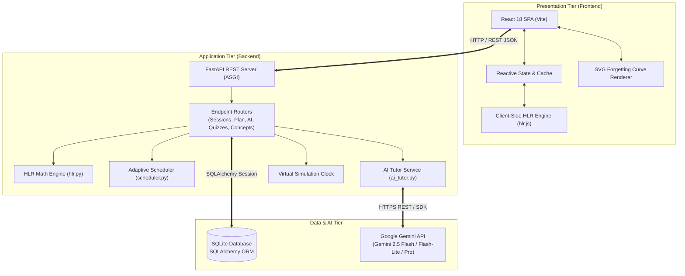
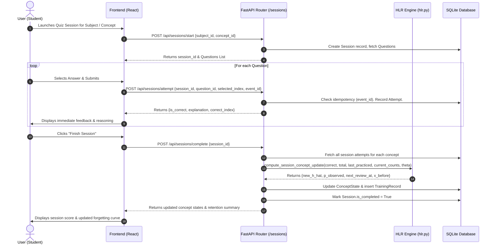

# System Architecture & High-Level Requirements (HLR)

## 1. Executive Summary

**FocusFlow** is an adaptive, spaced-repetition learning system that combines mathematical memory modeling with generative artificial intelligence. 

Standard spaced repetition software (such as Anki's SM-2 algorithm or Leitner box systems) relies on coarse heuristic intervals (e.g., doubling intervals upon success or manual "Easy/Good/Hard" grading). In contrast, FocusFlow implements **Half-Life Regression (HLR)**, an empirical model developed by Burr Settles and Brenda Meeder at Duolingo (ACL 2016). HLR models human forgetting as a continuous exponential decay function where the concept's half-life $h$ is predicted directly from past review statistics ($n_{correct}, n_{incorrect}$).

Coupled with the cognitive engine, FocusFlow integrates **Google Gemini** to transform passive flashcards into an interactive tutor: extracting concepts and quiz questions from raw notes, resolving doubts with step-by-step analogies, generating customized mnemonics, and providing Socratic chat guidance.

---

## 2. High-Level Requirements (HLR)

### 2.1 Functional Requirements
1. **Dynamic Memory Modeling**: Calculate and track memory half-life $h$ and recall probability $p$ in real-time for every user-concept pair.
2. **Adaptive Study Scheduling**: Allocate daily study budgets based on upcoming exam deadlines, subject priorities, and concept memory vulnerability (scheduling reviews before recall drops below a target threshold, e.g., $\tau = 0.70$).
3. **Active Recall Testing Engine**: Deliver multiple-choice and conceptual quizzes with real-time feedback, detailed explanations, and idempotent session tracking.
4. **AI-Powered Learning Assistance**:
   - **Socratic Study Buddy**: Conversational AI tutor providing hints, questions, and concept reviews without giving away direct quiz answers immediately.
   - **Deep Doubt Solver**: Multi-step conceptual breakdown with intuitive real-world analogies, identification of common pitfalls, and targeted check questions.
   - **Mnemonic Laboratory**: Generation of personalized memory anchors (acronyms, visual stories, rhymes, conceptual metaphors).
   - **Automatic Quiz Generation**: Ingestion of raw notes and study materials to generate structured multiple-choice questions with distractors and explanations.
5. **Memory Decay Visualization**: Interactive Ebbinghaus forgetting curve plots with dynamic parameter manipulation.
6. **Virtual Time-Travel Simulation**: Ability to simulate the passage of time (days/weeks) to observe memory decay and test scheduler responsiveness.

### 2.2 Non-Functional Requirements
1. **Fault Tolerance & Offline Resilience**: The client-side application must remain functional via an in-memory fallback simulation if the backend is unreachable.
2. **Idempotency**: Quiz answer submissions must support idempotency keys (`event_id`) to prevent duplicate attempt records during network jitter.
3. **Low Latency**: Dashboard metrics, plan generations, and curve computations must execute in $< 50$ ms.
4. **Clean Code & Testability**: 100% of core mathematical functions and API endpoints must be covered by automated test suites.

---

## 3. System Topology & Architecture

FocusFlow follows a decoupled client-server architecture consisting of three primary tiers:

---

## 4. Technology Stack

### 4.1 Frontend Tier
- **Framework**: [React 18](https://react.dev/) using functional components and hooks (`useState`, `useEffect`, `useMemo`, `useRef`).
- **Build Tool**: [Vite 6](https://vitejs.dev/) with hot module replacement (HMR) and optimized rollup production bundles.
- **Styling Architecture**: Pure **Vanilla CSS** adopting a curated **Editorial Paper Design System**:
  - Warm parchment base (`#f4f1eb`, `#ffffff`)
  - Deep forest slate accents (`#24312e`, `#1b2422`)
  - Terracotta alert highlights (`#df775d`, `#993c24`)
  - Sage green readiness markers (`#a5d5bf`, `#2d7a58`)
  - Typography: `Newsreader` (editorial serif), `Manrope` (clean geometric sans), and `DM Mono` (monospaced code and mathematical notation).
- **Icons**: [Lucide React](https://lucide.dev/) for feather-weight SVG iconography.
- **Data Visualizations**: Custom, responsive SVG curve generation with zero heavy external charting dependencies.

### 4.2 Backend Tier
- **Framework**: [FastAPI](https://fastapi.tiangolo.com/) (Python 3.10+) running on ASGI standard.
- **Server Engine**: [Uvicorn](https://www.uvicorn.org/) with auto-reloading worker processes.
- **Data Validation & Schemas**: [Pydantic v2](https://docs.pydantic.dev/) for strict typing, serialization, and OpenAPI schema generation.
- **Database ORM**: [SQLAlchemy 2.0](https://www.sqlalchemy.org/) providing session-managed relational mapping.
- **Database Engine**: **SQLite** (`focusflow.db`) with relational foreign keys, unique constraints, and JSON column support.
- **Automated Testing**: [Pytest](https://docs.pytest.org/) with test client fixtures for integration and unit verification.

### 4.3 AI & Cognitive Science
- **Cognitive Model**: Half-Life Regression (Settles & Meeder, Duolingo ACL 2016).
- **Generative AI Engine**: Google Gemini API via `google-genai` SDK and fallback HTTP endpoints, targeting `gemini-2.5-flash`, `gemini-2.5-flash-lite`, and `gemini-1.5-flash`.
- **Dynamic Configuration**: `app/core/config.py` with multi-path `.env` resolution for seamless local execution.

---

## 5. End-to-End Data Flow

### 5.1 Study Session & Active Recall Cycle

---

## 6. Key System Modules

| Module | Directory | Purpose |
| :--- | :--- | :--- |
| **HLR Engine** | [backend/app/services/hlr.py](file:///d:/Github%20repositories/FocusFlow/backend/app/services/hlr.py) | Mathematical implementation of Settles & Meeder (2016) half-life and recall probability equations. |
| **Adaptive Scheduler** | [backend/app/services/scheduler.py](file:///d:/Github%20repositories/FocusFlow/backend/app/services/scheduler.py) | Dynamic daily study plan generator prioritizing concepts with lowest recall probability $p$. |
| **AI Tutor Service** | [backend/app/services/ai_tutor.py](file:///d:/Github%20repositories/FocusFlow/backend/app/services/ai_tutor.py) | Prompts, structured output parsing, and fallbacks for Gemini Chat, Doubts, and Mnemonics. |
| **Material Pipeline** | [backend/app/services/quiz_gen.py](file:///d:/Github%20repositories/FocusFlow/backend/app/services/quiz_gen.py) | Ingests study notes and generates draft multiple-choice questions. |
| **Client HLR** | [frontend/src/hlr.js](file:///d:/Github%20repositories/FocusFlow/frontend/src/hlr.js) | Standalone ES6 module mirroring the Python mathematical formulas for zero-latency client updates. |
| **Virtual Clock** | [backend/main.py](file:///d:/Github%20repositories/FocusFlow/backend/main.py) | Controllable simulation clock allowing users to advance time and observe memory decay. |
