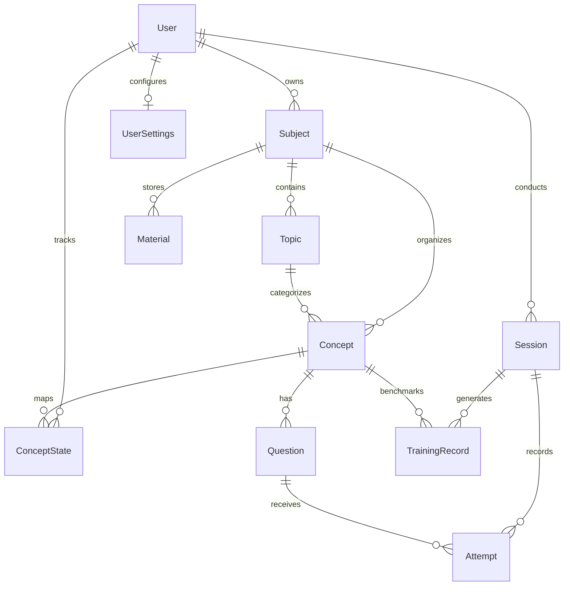

# Backend Architecture & API Specification

## 1. Overview

The FocusFlow backend is built on **FastAPI** (Python 3.10+) and **SQLAlchemy 2.0**. It exposes a high-performance RESTful API powering cognitive calculations, session lifecycle tracking, adaptive scheduling, and Gemini AI integrations.

### Key Architectural Strengths:
- **Asynchronous Execution**: Native `async/await` handling for non-blocking AI generation and high-throughput endpoints.
- **Relational Integrity**: SQLite database with strict foreign keys, composite indexes, and unique constraints.
- **Strict Data Contracts**: Full Pydantic v2 schema validation for request payloads and response serialization.
- **Idempotency**: Practice attempts require client-generated UUID `event_id` tokens, preventing duplicate score records caused by network latency or double-clicks.
- **Time-Travel Testing**: Integrated virtual clock simulation allowing automated tests and frontend users to leap days or weeks forward to test retention decay.

---

## 2. Directory Layout

```text
backend/
├── app/
│   ├── core/
│   │   ├── config.py           # Multi-path .env resolution & app settings
│   │   └── database.py         # SQLAlchemy engine, session maker & declarative Base
│   ├── models/
│   │   └── models.py           # Relational ORM entity definitions
│   ├── schemas/
│   │   └── schemas.py          # Pydantic validation models
│   ├── routers/
│   │   ├── ai_features.py      # Gemini Chat, Doubts, and Mnemonics
│   │   ├── concepts.py         # Concept states & forgetting curve points
│   │   ├── dashboard.py        # Overall readiness & critical concepts
│   │   ├── materials.py        # Notes ingestion & concept extraction
│   │   ├── plan.py             # Adaptive study schedule generation
│   │   ├── quizzes.py          # Question queries & draft approvals
│   │   ├── sessions.py         # Start session, log attempts, complete session
│   │   └── settings.py         # User settings & virtual clock
│   └── services/
│       ├── ai_tutor.py         # Gemini API client & prompt engineering
│       ├── hlr.py              # Settles & Meeder (2016) mathematical engine
│       ├── quiz_gen.py         # Heuristic & LLM quiz generation pipeline
│       └── scheduler.py        # Daily budget & priority optimization
├── tests/                      # Automated test suite (Pytest)
├── main.py                     # App factory, lifespan context & seed logic
├── requirements.txt            # Dependency manifest
└── focusflow.db                # SQLite database file
```

---

## 3. Database Schema & Relational Models

The relational schema is defined in [backend/app/models/models.py](file:///d:/Github%20repositories/FocusFlow/backend/app/models/models.py).



### 3.1 Entity Reference Table

| Table Name | Primary Model Class | Description | Key Columns / Constraints |
| :--- | :--- | :--- | :--- |
| `users` | `User` | Student profile record. | `id`, `username` (unique), `email` (unique). |
| `subjects` | `Subject` | Academic courses (e.g., AI, OS, Math). | `id`, `user_id` (FK), `name`, `color`, `priority_weight`. |
| `topics` | `Topic` | Conceptual chapters within subjects. | `id`, `subject_id` (FK), `name`. |
| `concepts` | `Concept` | Granular knowledge items. | `id`, `subject_id` (FK), `topic_id` (FK), `name`, `description`. |
| `questions` | `Question` | Active recall multiple-choice questions. | `id`, `concept_id` (FK), `text`, `options` (JSON), `answer_index`, `explanation`, `status`. |
| `sessions` | `Session` | Practice session wrapper. | `id`, `user_id` (FK), `subject_id` (FK), `is_completed`, `started_at`, `completed_at`. |
| `attempts` | `Attempt` | Individual question response log. | `id`, `session_id` (FK), `question_id` (FK), `concept_id` (FK), `event_id` (unique token), `is_correct`. |
| `concept_state` | `ConceptState` | User-concept memory model parameters. | `user_id` + `concept_id` (UniqueConstraint), `h_hat`, `p_hat_cached`, `total_correct`, `total_incorrect`, `next_review_at`. |
| `training_records` | `TrainingRecord` | Historical observations for offline ML retraining. | `id`, `user_id`, `concept_id`, `session_id`, `p` (observed), `delta_days`, `x_before` (JSON). |
| `model_versions` | `ModelVersion` | Active and historical HLR weight vectors. | `id`, `version_name`, `theta` (JSON), `feature_spec`, `is_active`. |
| `user_settings` | `UserSettings` | Daily time budget and target preferences. | `user_id` (FK, unique), `daily_minutes`, `subject_priorities` (JSON), `exam_dates` (JSON). |

---

## 4. Lifespan & Database Seeding

When FastAPI boots up via `main.py`, its `lifespan` context manager handles initialization:
1. `Base.metadata.create_all(bind=engine)` creates all database tables if they do not exist.
2. `seed_initial_data()` verifies if a default student user (`student1`) exists:
   - If missing, it automatically provisions subjects (*Artificial Intelligence*, *Operating Systems*, *Mathematics*, *Distributed Systems*).
   - Inserts representative concepts (e.g., *Backpropagation & Chain Rule*, *Scaled Dot-Product Attention*, *Page Replacement*, *Raft Leader Election*).
   - Creates approved multiple-choice questions with full explanations.
   - Sets baseline `ConceptState` records with default half-life $h = 2.0\text{ days}$.
   - Registers default launch weights $\boldsymbol{\theta}_{\text{launch}} = [1.0, 1.0, -1.0]$ in `model_versions`.

---

## 5. REST API Endpoint Directory

All endpoints are prefixed with `/api`.

### 5.1 Dashboard Router (`/api/dashboard`)
| Method | Endpoint | Description | Query / Body Params | Response Type |
| :--- | :--- | :--- | :--- | :--- |
| `GET` | `/api/dashboard/stats` | Aggregated readiness percentage, concepts due, streak count. | None | `DashboardStatsResponse` |
| `GET` | `/api/dashboard/critical` | List of concepts with $p < 0.50$ requiring urgent review. | None | `List[CriticalConceptItem]` |
| `GET` | `/api/dashboard/readiness-trend` | 7-day projected memory retention curve. | `days` (int, default 7) | `ReadinessTrendResponse` |

### 5.2 Sessions Router (`/api/sessions`)
| Method | Endpoint | Description | Query / Body Params | Response Type |
| :--- | :--- | :--- | :--- | :--- |
| `POST` | `/api/sessions/start` | Creates a new practice session and returns questions. | `subject_id` (opt), `concept_id` (opt), `count` (opt) | `SessionStartResponse` |
| `POST` | `/api/sessions/attempt` | Records answer, validates correctness, checks `event_id`. | `{session_id, question_id, selected_index, event_id}` | `AttemptFeedbackResponse` |
| `POST` | `/api/sessions/complete` | Concludes session, executes HLR updates, saves training records. | `{session_id}` | `SessionCompleteResponse` |

### 5.3 Adaptive Plan Router (`/api/plan`)
| Method | Endpoint | Description | Query / Body Params | Response Type |
| :--- | :--- | :--- | :--- | :--- |
| `GET` | `/api/plan/daily` | Generates prioritized study plan fitting within daily minutes budget. | `days_count` (int, default 1) | `PlanResponse` |

### 5.4 Concepts & Math Router (`/api/concepts`)
| Method | Endpoint | Description | Query / Body Params | Response Type |
| :--- | :--- | :--- | :--- | :--- |
| `GET` | `/api/concepts/` | Retrieves all concepts with their current $h$ and $p$. | `subject_id` (opt) | `List[ConceptResponse]` |
| `GET` | `/api/concepts/{concept_id}/curve` | Generates 40-point $(d, p)$ forgetting curve coordinates. | `threshold` (float, default 0.70) | `ForgettingCurveResponse` |

### 5.5 AI Tutoring Router (`/api/ai`)
| Method | Endpoint | Description | Query / Body Params | Response Type |
| :--- | :--- | :--- | :--- | :--- |
| `GET` | `/api/ai/status` | Reports whether Gemini API key is configured and active. | None | `{configured, model, status}` |
| `POST` | `/api/ai/chat` | Conversational Socratic study buddy with message history. | `{messages: [{role, content}], concept, subject}` | `{reply, role}` |
| `POST` | `/api/ai/solve-doubt` | Deep conceptual doubt resolution with analogies & checks. | `{doubt, concept, subject}` | `DoubtSolutionResponse` |
| `POST` | `/api/ai/mnemonics` | Generates 4 types of memory anchors (acronym, story, etc.). | `{concept_name, description, subject}` | `MnemonicResponse` |
| `POST` | `/api/ai/explain` | Generates pedagogical breakdown of why an answer was wrong. | `{question, chosen, correct, concept}` | `{explanation}` |

### 5.6 Quizzes & Materials Router (`/api/quizzes`, `/api/materials`)
| Method | Endpoint | Description | Query / Body Params | Response Type |
| :--- | :--- | :--- | :--- | :--- |
| `POST` | `/api/materials/upload` | Ingests study notes and triggers automated concept extraction. | `{subject_id, title, content}` | `MaterialResponse` |
| `POST` | `/api/quizzes/generate` | Generates draft multiple-choice questions from raw text. | `{material_id, num_questions}` | `List[DraftQuestionResponse]` |
| `POST` | `/api/quizzes/approve/{id}` | Approves draft question into the active testing bank. | None | `QuestionResponse` |

### 5.7 Settings & Simulation Clock (`/api/settings`)
| Method | Endpoint | Description | Query / Body Params | Response Type |
| :--- | :--- | :--- | :--- | :--- |
| `GET` | `/api/settings/` | Fetches current user settings (budget, exam dates). | None | `UserSettingsResponse` |
| `POST` | `/api/settings/` | Updates daily study minutes or subject multipliers. | `{daily_minutes, subject_priorities}` | `UserSettingsResponse` |
| `GET` | `/api/settings/clock` | Gets current simulated clock time. | None | `{simulated_time, is_simulated}` |
| `POST` | `/api/settings/clock` | Advances or resets the virtual simulation clock. | `{advance_days, reset}` | `{simulated_time}` |

---

## 6. Automated Testing Suite

The backend includes a comprehensive suite of unit and integration tests located in `backend/tests/`:
- **`test_hlr.py`**: Mathematical validation of half-life bounds, probability decay, monotonicity ($p(\Delta_1) > p(\Delta_2)$ for $\Delta_1 < \Delta_2$), and session updates.
- **`test_scheduler.py`**: Validates that concepts with the lowest recall probability $p$ are prioritized and study budgets are respected.
- **`test_sessions.py`**: End-to-end testing of session creation, attempt submission, idempotency checks, and HLR database state mutations.

To run the complete test suite:
```bash
cd backend
pytest tests/ -v
```
All **19 test cases** pass with zero failures.
