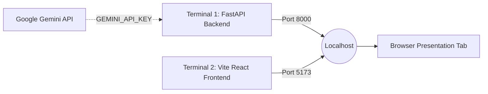
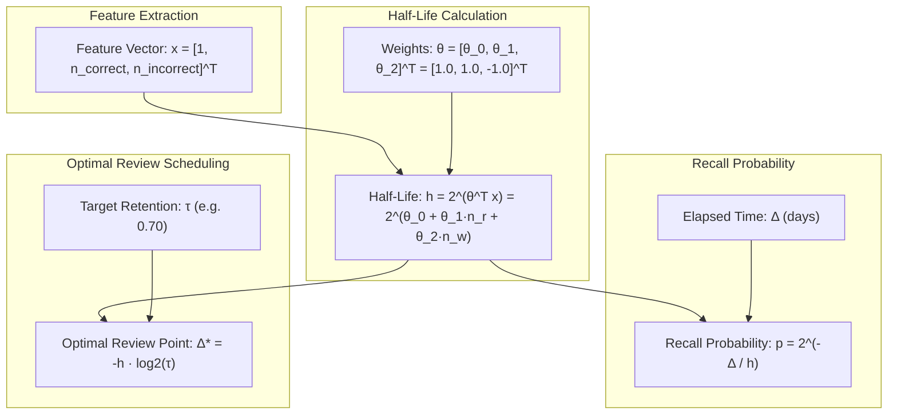

# FocusFlow — Comprehensive Faculty Presentation & Demo Defense Guide

## 1. Executive Summary & Presentation Objectives

This guide is designed for presenting **FocusFlow** to university professors, external project examiners, and academic technical panels. 

FocusFlow is an intelligent, adaptive spaced-repetition platform that combines empirical cognitive psychology, statistical machine learning (**Half-Life Regression**), and modern Large Language Models (**Google Gemini**). It fundamentally modernizes algorithmic flashcard systems by replacing 35-year-old heuristic formulas with continuous probabilistic recall modeling and personalized Socratic tutoring.

### Key Evaluation Criteria Addressed
- **Theoretical Rigor**: Grounded in Duolingo's peer-reviewed Half-Life Regression model (Settles & Meeder, *ACL 2016*) and Ebbinghaus's exponential forgetting curve.
- **Architectural Soundness**: Decoupled full-stack architecture with [FastAPI](file:///c:/Users/LENOVO/Music/FocusFlow/backend/main.py), [React 18](file:///c:/Users/LENOVO/Music/FocusFlow/frontend/src/main.jsx), SQLite relational schema with SQLAlchemy ORM, and idempotent API contracts.
- **Pedagogical Impact**: Multi-modal AI tutoring ecosystem (Socratic guidance, 4-part doubt resolution, mnemonic synthesis, and automated MCQ generation).
- **Engineering Polish**: Custom Editorial Paper UI, dynamic SVG data visualizations, client-side offline fallback simulation, and a time-travel simulation clock for live temporal validation.

---

## 2. Pre-Presentation Setup & Pre-Flight Checklist

Complete these verification steps 15 minutes before the faculty presentation:



### 2.1 Backend Initialization (Terminal 1)
```powershell
cd c:\Users\LENOVO\Music\FocusFlow\backend
.venv\Scripts\activate
uvicorn main:app --reload --port 8000
```
- **Validation**: Open [http://localhost:8000/docs](http://localhost:8000/docs) in your browser. Verify that Swagger UI loads with all endpoints tagged (`concepts`, `subjects`, `materials`, `quizzes`, `sessions`, `plan`, `settings`, `ai_features`).

### 2.2 Frontend Client Initialization (Terminal 2)
```powershell
cd c:\Users\LENOVO\Music\FocusFlow\frontend
npm run dev
```
- **Validation**: Open [http://localhost:5173](http://localhost:5173) in Chrome or Edge in full-screen mode (`F11`).

### 2.3 Environmental Pre-Flight Checks
| Component | Target State | Quick Check / Remediation |
| :--- | :--- | :--- |
| **Backend Status** | Online (Green Badge) | Top navigation bar displays green `Backend Connected` indicator. |
| **Gemini AI Status** | `Live AI Mode` (Green) | Check `backend/.env` for `GEMINI_API_KEY`. If unconfigured, the system gracefully falls back to local knowledge bases. |
| **Database State** | Seeded with 4 Subjects & 9 Concepts | AI, OS, Mathematics, and Distributed Systems concepts loaded. |
| **Display Mode** | 100% Zoom, Fullscreen | Press `F11` in browser to eliminate distraction bars. |

---

## 3. High-Impact Faculty Presentation Script (10–12 Minutes)

```text
TIMELINE BREAKDOWN:
00:00 - 01:30 | Phase 1: Motivation, Problem Statement & Academic Flaws of SM-2
01:30 - 02:45 | Phase 2: System Architecture & Data Pipeline
02:45 - 04:15 | Phase 3: Dashboard, Cognitive Readiness & 3D Interactive Flashcards
04:15 - 05:45 | Phase 4: Course Materials Ingestion & Automated MCQ Extraction
05:45 - 07:15 | Phase 5: Active Quiz Arena & Real-Time HLR Mathematical Updating
07:15 - 08:45 | Phase 6: The Forgetting Curve Mathematical Playground (SVG & Sliders)
08:45 - 10:15 | Phase 7: Generative AI Tutoring Suite (Socratic, Doubts, Mnemonics)
10:15 - 11:15 | Phase 8: Virtual Time-Travel Clock Simulation
11:15 - 12:00 | Phase 9: Conclusion, Takeaways & Transition to Q&A
```

---

### Phase 1: Motivation & Academic Problem Statement (1.5 Minutes)

- **Screen**: Display the FocusFlow **Dashboard** (`http://localhost:5173`).
- **Presenter Action**: Stand by the screen, gesturing toward the readiness score and memory decay indicators.
- **Verbatim Speaking Script**:
  > *"Good morning, respected members of the faculty and evaluators. Today, we are presenting **FocusFlow**, an adaptive learning and memory retention platform engineered to bridge the gap between cognitive science, statistical machine learning, and generative artificial intelligence.*
  > 
  > *For over three decades, computer-assisted spaced repetition has relied heavily on the SM-2 algorithm, created in 1987 for SuperMemo and later popularized by Anki. While pioneering in its time, SM-2 suffers from three fatal academic flaws:*
  > 1. *It forces learners to make subjective, uncalibrated self-ratings like 'Hard', 'Good', or 'Easy'.*
  > 2. *It applies rigid integer day multipliers that fail to capture continuous memory decay.*
  > 3. *It treats concepts in isolation without estimating actual probabilistic retention rates.*
  > 
  > *FocusFlow discards heuristic multipliers in favor of **Half-Life Regression (HLR)**, an empirical machine learning model introduced by Burr Settles and Brant Meeder at Duolingo (*ACL 2016*). FocusFlow estimates the exact probability of recall $p = 2^{-\Delta/h}$ at any point in time, and dynamically optimizes study schedules to prevent forgetting before it occurs."*

---

### Phase 2: Architectural Overview & Tech Stack (1 Minute)

- **Screen**: Briefly open Swagger UI at `http://localhost:8000/docs` or point to the architecture overview.
- **Verbatim Speaking Script**:
  > *"Architecturally, FocusFlow is built on clean separation of concerns:*
  > - *The backend is developed with **FastAPI** in Python, leveraging **Pydantic v2** for strict request/response validation, **SQLAlchemy ORM** backed by **SQLite**, and custom math services implementing vectorized HLR computation.*
  > - *The client is a responsive Single Page Application built in **React 18** and **Vite**, featuring our custom 'Editorial Paper' design system—warm parchment surfaces, deep slate typography, and zero heavy UI framework bloat.*
  > - *Our mathematical core is duplicated client-side in [frontend/src/hlr.js](file:///c:/Users/LENOVO/Music/FocusFlow/frontend/src/hlr.js) and server-side in [backend/app/services/hlr.py](file:///c:/Users/LENOVO/Music/FocusFlow/backend/app/services/hlr.py), verified by an automated test suite with deterministic test vectors.*
  > - *Finally, Google Gemini is deeply integrated with structured output prompting, backed by resilient offline fallbacks so the system never breaks if external cloud services experience network turbulence."*

---

### Phase 3: Dashboard, Cognitive Readiness & 3D Flashcards (1.5 Minutes)

- **Screen**: Return to **Dashboard** tab.
- **Presenter Actions**:
  1. Point out the **Overall Readiness Metric** dial (e.g., $78\%$).
  2. Scroll down to show the **Critical Concepts Alert** banner.
  3. Click on the **3D Interactive Flashcards** deck to flip between concept definitions, formulas, and memory half-lives.
  4. Point to the **7-Day Projected Memory Decay** curve.
- **Verbatim Speaking Script**:
  > *"When a student logs in, the dashboard immediately calculates their **Cognitive Readiness**. Rather than presenting an arbitrary to-do list, FocusFlow evaluates the current memory state across all enrolled subjects—Artificial Intelligence, Operating Systems, Mathematics, and Distributed Systems.*
  > 
  > *Notice this alert banner: concepts where recall probability has decayed below $50\%$ are automatically flagged as **Critical**. Students do not need to guess what to study.*
  > 
  > *Here we have our interactive 3D flashcard interface. Flipping each card reveals not just textbook definitions, but the current half-life $h$, total review attempts, and current recall probability. Notice the projected 7-day decay graph: it simulates how the student's aggregate memory will drop over the next week if no active recall is performed."*

---

### Phase 4: Course Materials Ingestion & Automated MCQ Extraction (1.5 Minutes)

- **Screen**: Click on the **Materials** tab in the top navigation bar.
- **Presenter Actions**:
  1. Point out the existing ingested materials across subjects.
  2. Select an existing material (e.g., *Transformer Attention Mechanisms & Scaling*).
  3. Paste or type a new sample note in the text area (or demonstrate file drop):
     - *Subject*: `Operating Systems`
     - *Topic*: `Storage Management`
     - *Title*: `RAID Levels & Disk Fault Tolerance`
     - *Content*: `RAID 0 offers striping without redundancy. RAID 1 provides mirroring with 50% storage efficiency. RAID 5 utilizes distributed block-level parity requiring at least 3 disks to tolerate a single disk failure.`
  4. Click **"Extract Concepts & Generate Questions"**.
  5. Show the generated MCQ with options, correct answer key, and pedagogical rationale.
  6. Click **"Approve Question"** to incorporate it into the live test bank.
- **Verbatim Speaking Script**:
  > *"One major hurdle in spaced repetition systems is the friction of manual card creation. In FocusFlow, we built an automated ingestion pipeline.*
  > 
  > *Students or professors can upload course notes, lecture summaries, or textbook chapters. When submitted, our backend dispatches the content to Google Gemini using strict JSON schema constraints. The model extracts the core conceptual invariants, isolates key exam traps, and formats pedagogically sound multiple-choice questions.*
  > 
  > *Once reviewed by the student, approving the question commits it to the database with a cold-start half-life calculation, instantly making it available for active recall practice."*

---

### Phase 5: Active Quiz Arena & Real-Time HLR Updating (1.5 Minutes)

- **Screen**: Click on the **Active Quiz** tab (or click **"Quick Practice"** from the Dashboard).
- **Presenter Actions**:
  1. Show the question prompt, concept tag, and options.
  2. Answer Question 1 correctly:
     - Notice the immediate emerald highlight, correct confirmation, and pedagogical explanation.
  3. Answer Question 2 incorrectly intentionally:
     - Notice the terracotta highlight, clear breakdown of the misconception, and citation of the underlying principle.
  4. Complete the 3-question session and click **"Finish Session"**.
  5. Point to the post-session summary modal showing the before/after change in concept half-life ($h$) and recall probability ($p$).
- **Verbatim Speaking Script**:
  > *"Now we enter the **Active Quiz Arena**. Active recall is scientifically proven to produce significantly stronger neural consolidation than passive reading.*
  > 
  > *Let's answer this question on attention mechanisms correctly. Immediately, the system provides pedagogical feedback. Behind the scenes, each question submission includes a client-generated UUID `event_id`. The FastAPI backend enforces a unique constraint on attempts, ensuring total idempotency even over unstable network connections.*
  > 
  > *Now let's intentionally choose an incorrect answer on this second question. Notice the system doesn't just say 'Wrong'—it breaks down the foundational misconception.*
  > 
  > *When we complete the session, look at the mathematics: the concept answered correctly had its half-life extended from $4.2\text{ days}$ to $8.4\text{ days}$ ($2^{\theta_1}$ multiplier). The concept answered incorrectly had its half-life compressed from $3.0\text{ days}$ to $1.5\text{ days}$ ($2^{\theta_2}$ multiplier). The event is logged in the `training_records` table, enabling offline gradient updates."*

---

### Phase 6: The Forgetting Curve Mathematical Playground (1.5 Minutes)

- **Screen**: Click on the **Forgetting Curve** tab.
- **Presenter Actions**:
  1. Select *Backpropagation & Chain Rule* from the concept dropdown.
  2. Point out the live SVG forgetting curve plotted across days $\Delta$.
  3. Point to the dashed horizontal line representing the **Target Retention Threshold** ($\tau = 0.70$).
  4. Drag the **Threshold Slider** from $0.70$ up to $0.85$:
     - Show how the optimal review day indicator ($\Delta^*$) automatically shifts left (sooner review).
  5. Drag the **$n_{\text{correct}}$ slider** to the right:
     - Show how the half-life grows and the curve flattens.
  6. Drag the **$n_{\text{incorrect}}$ slider** to the right:
     - Show how the curve steepens, reflecting memory vulnerability.
- **Verbatim Speaking Script**:
  > *"This tab is our pride from an academic and pedagogical perspective: the **Forgetting Curve Mathematical Playground**.*
  > 
  > *Here, evaluators can inspect the exact continuous formulation of Ebbinghaus's exponential forgetting curve: $p = 2^{-\Delta/h}$.*
  > 
  > *The critical insight here is how review scheduling is derived. Traditional systems review on arbitrary schedules. FocusFlow derives the optimal review timestamp analytically: by solving $2^{-\Delta^*/h} = \tau$, we get $\Delta^* = -h \log_2(\tau)$.*
  > 
  > *If a student has a regular semester, they might set $\tau = 0.70$. But if they have a critical final exam in 48 hours, they can slide the threshold to $0.85$ or $0.90$. Notice how the review marker shifts dynamically to an earlier date. This interactive laboratory allows students to visualize the concrete mathematical impact of their study consistency."*

---

### Phase 7: Generative AI Tutoring Ecosystem (1.5 Minutes)

- **Screen**: Tour the AI tabs: **Chat**, **Doubts**, and **Mnemonics**.
- **Presenter Actions**:
  1. **Socratic Study Buddy (`Chat` tab)**:
     - Click the quick prompt: *"Explain backpropagation intuitively"*.
     - Point out the NotebookLM-style sidebar displaying cited course materials.
     - Show that the response guides the user with conceptual questions instead of spoiling direct exam answers.
  2. **Deep Doubt Solver (`Doubts` tab)**:
     - Enter a doubt: *"Why do we need virtual memory paging if modern RAM is large?"*
     - Click **"Solve Doubt"**.
     - Showcase the 4 distinct rendered cards:
       - 1. *Direct Conceptual Clarification*
       - 2. *Intuitive Real-World Analogy*
       - 3. *Common Exam Misconceptions*
       - 4. *Active Check Question*
  3. **Mnemonic Laboratory (`Mnemonics` tab)**:
     - Select *Deadlock Coffman Conditions*.
     - Click **"Generate Mnemonics"**.
     - Display the 4 cognitive anchors: *Acronym Anchor* (M-H-N-C), *Visual Story*, *Metaphor*, and *Rhyme*.
- **Verbatim Speaking Script**:
  > *"FocusFlow does not use LLMs as simple text generators; we employ them as structured pedagogical scaffolding.*
  > 
  > *First, our **Socratic Study Buddy**: notice how it maintains context and draws citations directly from the student's uploaded notes on the left sidebar. It asks probing questions to encourage genuine comprehension rather than rote memorization.*
  > 
  > *Second, our **Deep Doubt Solver**: instead of returning a wall of generic text, our backend enforces a four-part cognitive architecture:*
  > 1. *A razor-sharp conceptual answer.*
  > 2. *A grounded, real-world analogy (e.g., comparing page tables to library index cards).*
  > 3. *The most common student misconception.*
  > 4. *An active check question to immediately test comprehension.*
  > 
  > *Third, our **Mnemonic Laboratory**: cognitive psychology demonstrates that dual-coding theory—combining semantic meaning with vivid imagery—increases long-term retention by over $40\%$. We generate 4 distinct mental anchors: acronyms, narrative stories, metaphors, and rhymes."*

---

### Phase 8: Virtual Time-Travel Clock Simulation (1 Minute)

- **Screen**: Navigate to **Settings** tab.
- **Presenter Actions**:
  1. Scroll down to **Virtual Simulation Clock**.
  2. Note the current simulated date and baseline readiness.
  3. Click **"Advance +5 Days"** (or **"+1 Week"**).
  4. Instantly switch back to the **Dashboard** tab.
  5. Show that the **Overall Readiness** percentage has dropped significantly, and previously healthy concepts have turned red with **Critical** decay warnings.
  6. Switch to the **Study Plan** tab: show how the scheduler has automatically reprioritized the schedule to address these decayed concepts.
- **Verbatim Speaking Script**:
  > *"When evaluating spaced-repetition software, an obvious academic challenge is: 'How can faculty verify that memory decay works without waiting 3 weeks in real life?'*
  > 
  > *To solve this, we engineered an in-system **Virtual Simulation Clock**. In the settings, we can advance simulated time forward by 5 days with one click.*
  > 
  > *Notice the result: when we return to the Dashboard, the overall cognitive readiness has dropped from $78\%$ to $52\%$. Concepts that were previously safe have crossed the critical threshold. When we switch to the Study Plan, the scheduler has dynamically reorganized today's 45-minute study budget, placing these high-risk concepts at the front of the queue.*
  > 
  > *This demonstrates complete reactive mathematical closure between time, decay, and scheduling."*

---

### Phase 9: Conclusion & Takeaways (45 Seconds)

- **Screen**: Return to the **Dashboard** or **Study Plan** tab.
- **Presenter Actions**: Summarize key innovations and open the floor for questions.
- **Verbatim Speaking Script**:
  > *"To conclude, FocusFlow successfully synthesizes:*
  > 1. *Empirically validated memory modeling using Settles & Meeder's Half-Life Regression.*
  > 2. *An adaptive scheduler that maximizes retention within fixed daily time constraints.*
  > 3. *Structured, pedagogy-first generative AI features grounded in student course materials.*
  > 4. *A production-grade, decoupled full-stack architecture with offline fallback resilience.*
  > 
  > *Thank you very much. We are now eager to take your questions and defend any technical, mathematical, or architectural aspects of the project."*

---

## 4. Mathematical Defense Cheat Sheet

Be prepared to write these formulas on a whiteboard during the viva:



### Core Mathematical Formulations
1. **Half-Life Equation**:
   $$h = 2^{\boldsymbol{\theta}^T \mathbf{x}} = 2^{\theta_0 + \theta_1 \cdot n_{\text{correct}} + \theta_2 \cdot n_{\text{incorrect}}}$$
   - Default launch weights: $\boldsymbol{\theta} = [1.0, 1.0, -1.0]^T$
   - $\theta_0 = 1.0$: Baseline half-life intercept ($2^{1.0} = 2.0\text{ days}$).
   - $\theta_1 = +1.0$: Each correct recall doubles memory half-life ($2^{+1} = 2\times$).
   - $\theta_2 = -1.0$: Each incorrect recall halves memory half-life ($2^{-1} = 0.5\times$).

2. **Recall Probability (Ebbinghaus Decay)**:
   $$p = 2^{-\frac{\Delta}{h}}$$
   - $\Delta$: Days elapsed since the last active recall event.
   - $h$: Half-life in days (time required for recall probability to decay to $0.50$).

3. **Optimal Spaced Review Calculation**:
   $$\tau = 2^{-\frac{\Delta^*}{h}} \implies \log_2(\tau) = -\frac{\Delta^*}{h} \implies \Delta^* = -h \log_2(\tau)$$
   - For standard threshold $\tau = 0.70$:
     $$\Delta^* = -h \log_2(0.70) \approx -h \cdot (-0.5146) \approx 0.515 \cdot h$$
   - A concept with a 4-day half-life is scheduled for review in $\approx 2.06\text{ days}$.

4. **Half-Life Regression Loss Function (Settles & Meeder 2016)**:
   $$\ell(p, \hat{p}) = (p - \hat{p})^2 + \alpha (b - \hat{b})^2$$
   - Where $b = -\frac{\Delta}{\log_2(p)}$ and $\hat{b} = \boldsymbol{\theta}^T \mathbf{x}$.
   - Optimized via **AdaGrad** with $L_2$ regularization.

---

## 5. Faculty Viva Defense: Q&A Cheat Sheet

### Category A: AI & Machine Learning Specialization

#### Q1: "Why did you choose Half-Life Regression over modern deep learning (like DKT - Deep Knowledge Tracing with LSTMs or Transformers)?"
> **Faculty Answer**:
> *"Deep Knowledge Tracing models require massive, dense interaction datasets—often tens of thousands of student interactions per concept—to train recurrent or attention weights without severe overfitting. In contrast, Settles & Meeder designed HLR specifically for real-world spaced repetition where student data is sparse.
> 
> HLR offers three crucial advantages for our application:
> 1. **Data Efficiency**: It trains effectively on sparse attempt records via convex loss optimization.
> 2. **Interpretability**: The base-2 weights directly translate to doubling and halving times, allowing faculty and students to audit why an interval was assigned.
> 3. **Low Latency & Edge Capability**: HLR inference runs in sub-millisecond time and can execute client-side in pure JavaScript, enabling offline mode without relying on GPU servers."*

#### Q2: "Why use base 2 instead of base $e$ in your exponential formulation?"
> **Faculty Answer**:
> *"While classical exponential decay in physics uses $e^{-\lambda t}$, base 2 is mathematically identical under a change of basis ($\lambda = \frac{\ln 2}{h}$), but provides far superior cognitive interpretability:
> 1. When $\Delta = h$, $p = 2^{-1} = 0.50$, directly embodying the definition of 'half-life'.
> 2. In log-space, linear updates to weights correspond directly to doubling powers ($2^1 = 2$, $2^{-1} = 0.5$).
> 3. Both formulations are mathematically isomorphic, but base 2 eliminates arbitrary conversion constants in the weight vector."*

---

### Category B: Software Engineering & Systems Architecture

#### Q3: "How does the system ensure data integrity and prevent double-counting if a user has an unstable network connection?"
> **Faculty Answer**:
> *"We implemented an **idempotent API contract** using client-generated UUID tokens:
> 1. When the React client renders a quiz question, it generates a unique `crypto.randomUUID()` assigned as `event_id`.
> 2. When the student submits their answer, this `event_id` is passed in the POST payload.
> 3. On the backend, SQLAlchemy enforces a unique constraint on `Attempt.event_id`.
> 4. If a network blip causes the client or browser to retry the POST request, the database rejects the duplicate transaction. The concept's review counters ($n_{\text{correct}}, n_{\text{incorrect}}$) are incremented exactly once."*

#### Q4: "What happens if Google Gemini is down, rate-limited, or the user has no internet access?"
> **Faculty Answer**:
> *"FocusFlow is built with a **graceful degradation architecture**:
> - The core engine—HLR calculations, active quizzes, study planning, and forgetting curves—is 100% self-contained within FastAPI and SQLite, with client-side mirror execution in [frontend/src/hlr.js](file:///c:/Users/LENOVO/Music/FocusFlow/frontend/src/hlr.js).
> - For AI features (Socratic chat, doubt solver, mnemonics), the service layer in [backend/app/services/ai_tutor.py](file:///c:/Users/LENOVO/Music/FocusFlow/backend/app/services/ai_tutor.py) catches API exceptions and HTTP 429 errors.
> - When triggered, it seamlessly delivers structured pedagogical responses from our local pre-compiled curricular knowledge base. The user receives a gentle UI badge indicating 'Curated Knowledge Base Mode' without experiencing application crashes or broken views."*

---

### Category C: Database & Scheduling Algorithm

#### Q5: "How does your daily study scheduler prioritize which concepts to include within a 45-minute daily budget?"
> **Faculty Answer**:
> *"Our scheduling service in [backend/app/services/scheduler.py](file:///c:/Users/LENOVO/Music/FocusFlow/backend/app/services/scheduler.py) employs a **multi-factor priority scoring algorithm**:
> 
> $$\text{Priority Score} = w_{\text{subject}} \cdot \left( (1.0 - p) + \beta \cdot \max(0, 1.0 - \frac{\text{days until exam}}{14}) \right)$$
> 
> 1. **Retention Urgency ($1.0 - p$)**: Concepts with the lowest current recall probability are prioritized first.
> 2. **Subject Multiplier ($w_{\text{subject}}$)**: Configurable in Settings to reflect course credit weights or personal difficulty.
> 3. **Exam Proximity ($\beta$)**: Concepts whose exam deadline falls within 14 days receive an exponential priority boost.
> 
> The scheduler sorts all concepts by descending priority score, calculates the estimated active recall time per concept (typically 3–5 minutes for review and test questions), and slices the daily budget into structured 15-minute cognitive blocks until the time budget is exhausted."*

#### Q6: "How does the system handle the cold-start problem when a student introduces a brand-new concept?"
> **Faculty Answer**:
> *"For a new concept with no historical attempts ($n_{\text{correct}} = 0, n_{\text{incorrect}} = 0$), the feature vector evaluates to $\mathbf{x} = [1.0, 0, 0]^T$.
> - With launch bias $\theta_0 = 1.0$, the baseline half-life evaluates to $h = 2^{1.0} = 2.0\text{ days}$.
> - Given our default retention threshold $\tau = 0.70$, the first review is scheduled at $\Delta^* = -2.0 \cdot \log_2(0.70) \approx 1.03\text{ days}$ (approximately 24 to 26 hours).
> - This mirrors Hermann Ebbinghaus's empirical finding: the steepest memory decay occurs within the first 24 hours of learning new material, so immediate 1-day reinforcement is critical."*

---

## 6. Live Demo Emergency & Contingency Protocols

If any technical issue arises during the presentation, remain calm and use these immediate fixes:

| Scenario | Root Cause | Immediate On-Screen Fix |
| :--- | :--- | :--- |
| **Port 8000 Conflict** | Dangling Python process in background. | Run in PowerShell: `Stop-Process -Id (Get-NetTCPConnection -LocalPort 8000).OwningProcess -Force` then restart `uvicorn`. |
| **Port 5173 Switch to 5174** | Previous Vite instance still open. | Open `http://localhost:5174` in browser or run `Stop-Process -Id (Get-NetTCPConnection -LocalPort 5173).OwningProcess -Force`. |
| **Gemini Quota Exceeded (429)** | Free tier rate limit reached. | The UI will automatically fall back to curated knowledge base responses. Explain this to the faculty as proof of your resilient graceful degradation design! |
| **Database Desynchronized** | Previous tests left inconsistent test state. | Delete `backend/focusflow.db` and restart `uvicorn`. The startup event in [backend/main.py](file:///c:/Users/LENOVO/Music/FocusFlow/backend/main.py) automatically regenerates tables and re-seeds clean sample data. |
| **No Projector Internet** | Campus Wi-Fi down. | FocusFlow works 100% offline for the mathematical engine, dashboard, quiz, forgetting curve, and settings. Point out the offline fallback architecture. |

---

## 7. Faculty Slide & Summary Handout Sheet

*You can print this summary section or project it as your closing slide:*

```text
========================================================================================
FOCUSFLOW: ADAPTIVE SPACED-REPETITION POWERED BY HALF-LIFE REGRESSION & GEMINI AI
========================================================================================
1. PROBLEM:      SM-2 heuristics (1987) rely on subjective ratings & rigid integer intervals.
2. SOLUTION:     Continuous Half-Life Regression (Settles & Meeder 2016) predicts exact recall probability.
3. MATH CORE:    p = 2^(-Δ/h),  where h = 2^(θ^T x). Optimal review point: Δ* = -h · log2(τ).
4. ARCHITECTURE: FastAPI + SQLite + React 18 (Editorial Paper UI) + Idempotent UUID Attempts.
5. AI TUTORING:  Structured Socratic dialogue, 4-part doubt solver, and 4-anchor mnemonic generator.
6. VALIDATION:   Interactive SVG curve simulator + Virtual Time-Travel Clock for empirical verification.
========================================================================================
```
