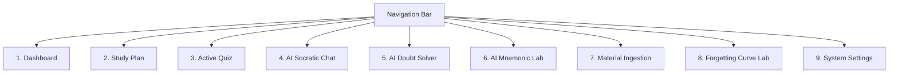

# Frontend Architecture & UI Design System Guide

## 1. Overview & Philosophy

The FocusFlow frontend is a responsive Single Page Application (SPA) built with **React 18** and **Vite 6**. 

Rather than relying on generic CSS frameworks (like standard Bootstrap or default Tailwind utility soup), FocusFlow features an original, handcrafted **Editorial Paper Design System**. The visual design evokes the tactile, focused experience of a premium academic notebook, combining warm paper surfaces, deep slate typography, terracotta urgency markers, and sage green retention indicators.

---

## 2. Design System & Style Tokens

All styles are defined centrally in [frontend/src/styles.css](file:///d:/Github%20repositories/FocusFlow/frontend/src/styles.css).

### 2.1 Color Palette Tokens

```css
:root {
  /* Surface & Background */
  --bg-primary: #f4f1eb;          /* Warm parchment background */
  --bg-surface: #ffffff;          /* Crisp card surface */
  --bg-subtle: #ece7de;           /* Inset panels & table headers */
  --border-color: #dcd6cb;        /* Refined paper border */
  --border-focus: #24312e;        /* Dark outline on focus */

  /* Typography Colors */
  --text-primary: #24312e;        /* Deep forest slate body */
  --text-secondary: #576561;      /* Readable secondary description */
  --text-muted: #83918d;          /* Micro-labels and footnotes */

  /* Functional Accents */
  --accent-sage: #a5d5bf;         /* Memory stable / high recall */
  --accent-sage-dark: #2d7a58;    /* Dark sage for readable text */
  --accent-terracotta: #df775d;   /* Memory critical / low recall */
  --accent-terracotta-dark: #993c24; /* Dark terracotta for badges */
  --accent-slate: #24312e;        /* Primary action button fill */
  --accent-cream: #faf8f5;        /* Soft card highlight */
}
```

### 2.2 Typography Stack
FocusFlow loads three complementary typefaces via Google Fonts in [frontend/index.html](file:///d:/Github%20repositories/FocusFlow/frontend/index.html):

| Typeface | Class / Usage | Purpose |
| :--- | :--- | :--- |
| **Newsreader** | `font-serif`, `h1`, `h2`, quotes | Editorial, human, bookish tone for major section headers. |
| **Manrope** | Default body font | Clean, modern geometric sans-serif ensuring optimal legibility. |
| **DM Mono** | `font-mono`, stats, math variables | Monospaced precision for numbers, time intervals, and formulas ($h, p, \Delta$). |

---

## 3. Client Architecture & File Structure

```text
frontend/
├── src/
│   ├── hlr.js          # Standalone client-side HLR mathematical simulator
│   ├── main.jsx        # Root component orchestrating the 9 tab views & API sync
│   └── styles.css      # Editorial Paper design system & animation keyframes
├── index.html          # HTML5 entry with meta tags & Google Fonts
├── package.json        # Dependencies (React 18, Lucide React, Vite)
└── vite.config.js      # Vite build configuration with proxy rules
```

---

## 4. The 9 Tab Views

FocusFlow organizes its workflow into 9 distinct tabs accessible via the top navigation bar:



### 4.1 Dashboard (`dashboard`)
- **Readiness Metric**: High-level percentage score indicating overall memory retention across all subjects.
- **Critical Concepts Banner**: Highlights concepts where recall probability has dropped below $50\%$ ($p < 0.50$).
- **Quick Practice Launcher**: Starts a targeted quiz session with one click.
- **Interactive 3D Flashcards**: Flip-card deck displaying concept definitions with front/back 3D perspective transitions.
- **Projected 7-Day Retention Trend**: Real-time projection of how overall retention will decay over the coming week if no study is performed.

### 4.2 Study Plan (`plan`)
- **Adaptive Daily Schedule**: Automatically allocates concepts into 15-minute study blocks based on the student's daily time budget.
- **Priority Weighing**: Balances urgent concepts ($p < \tau$) against upcoming exam dates and subject multipliers.
- **Estimated Question Counts**: Estimates how many active recall questions are needed per block to restore retention.

### 4.3 Active Quiz (`quiz`)
- **Real-Time Active Recall**: Delivers multiple-choice questions one at a time.
- **Instantaneous Pedagogical Feedback**: Immediately informs the student whether their choice was correct or incorrect, revealing the complete explanation and the exact underlying concept.
- **Idempotency Guarantee**: Submissions include a unique `event_id` token generated via `crypto.randomUUID()`.
- **Session Progress Bar**: Visual indicator showing remaining questions in the active batch.

### 4.4 AI Socratic Study Buddy (`chat`)
- **Conversational Memory**: Retains multi-turn chat context across student inquiries.
- **Socratic Guidance**: Trained via system prompts to ask probing questions and provide conceptual hints rather than simply giving away multiple-choice answers.
- **Quick-Prompt Chips**: One-click prompt starters (e.g., *"Explain backpropagation intuitively"*, *"How does Raft elect a leader?"*).

### 4.5 AI Deep Doubt Solver (`doubts`)
- Dedicated resolution workflow for complex doubts, breaking the response into four structured pedagogical sections:
  1. **Direct Conceptual Clarification**: Concise, accurate explanation.
  2. **Intuitive Real-World Analogy**: Grounded metaphors (e.g., comparing database locks to hotel room keys).
  3. **Common Misconceptions**: Highlights what students frequently get wrong.
  4. **Active Check Question**: A quick concept test to verify immediate understanding.

### 4.6 AI Mnemonic Laboratory (`mnemonics`)
- Generates 4 tailored memory anchors for any concept:
  - **Acronym Anchor**: Memorable letter abbreviations.
  - **Visual Story Anchor**: Vivid, narrative mental imagery.
  - **Metaphor Anchor**: Everyday functional comparisons.
  - **Rhyme / Phonetic Anchor**: Catchy phonetic phrase.
- Includes a one-click copy button and a "Memory Hook" takeaway.

### 4.7 Course Materials Ingestion (`materials`)
- Ingests raw lecture notes, markdown summaries, or textbook transcripts.
- AI pipeline extracts core concepts and drafts multiple-choice questions for review.
- Instructors or students can approve draft questions directly into their permanent test bank.

### 4.8 Forgetting Curve Visualizer (`curve`)
- **Interactive Mathematical Playground**: Live SVG rendering of the Ebbinghaus forgetting curve ($p = 2^{-\Delta/h}$).
- **Dynamic Parameter Sliders**: Real-time manipulation of:
  - $n_{\text{correct}}$ and $n_{\text{incorrect}}$ counts.
  - Model weights ($\theta_0, \theta_1, \theta_2$).
  - Target retention threshold $\tau$ (with live horizontal threshold reference line).
- Shows exact review day calculation ($\Delta^* = -h \log_2(\tau)$).

### 4.9 Settings & Virtual Clock (`settings`)
- **Study Budget Adjuster**: Configure daily minutes budget (15m to 180m).
- **Subject Multipliers**: Adjust priority weights for specific courses.
- **Virtual Time-Travel Controls**: Advance simulated time by +1 day, +3 days, or +1 week to test how the scheduler and forgetting curves respond to the passage of time.

---

## 5. Client-Side HLR Mathematical Simulator (`hlr.js`)

To ensure high responsiveness and full offline capability, the client implements a mirrored version of the Python HLR mathematical engine in [frontend/src/hlr.js](file:///d:/Github%20repositories/FocusFlow/frontend/src/hlr.js):

```javascript
// Example functions exported by hlr.js:
export function calcHalfLife(nCorrect, nIncorrect, theta = LAUNCH_THETA) {
  const linearComb = theta[0] + (theta[1] * nCorrect) + (theta[2] * nIncorrect);
  const clampedComb = Math.min(Math.max(linearComb, -10.0), 12.0);
  const h = Math.pow(2.0, clampedComb);
  return Math.min(Math.max(h, H_MIN), H_MAX);
}

export function calcRecallProb(h, deltaDays) {
  const power = -Math.max(0, deltaDays) / Math.max(h, H_MIN);
  if (power < -20.0) return P_MIN;
  return Math.min(Math.max(Math.pow(2.0, power), P_MIN), P_MAX);
}

export function calcNextReviewDays(h, threshold = 0.7) {
  const log2Thresh = Math.log2(Math.min(Math.max(threshold, P_MIN), P_MAX));
  return Math.max(H_MIN, -h * log2Thresh);
}
```

### Why Dual Implementation?
1. **Zero-Latency UI**: Slider changes in the Forgetting Curve Lab update at 60 FPS without waiting for backend network requests.
2. **Offline Resilience**: If the backend server is stopped, the frontend continues to score quizzes, advance half-lives, and plot forgetting curves seamlessly using client memory.
